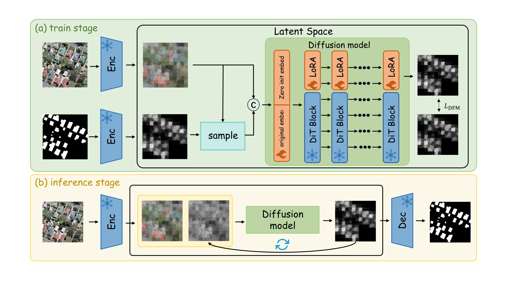

    <h2>
        BuildFlow: Rethinking Building Extraction from High-Resolution Remote Sensing Imagery as Deterministic Continuous Evolution
    </h2>
    

        <a href="https://qwerasdzxhjk.github.io">Taochang Liu</a>, <a href="http://www.sysuzxc.site">Xinchang Zhang</a>, <a href="https://scholar.google.com/citations?hl=zh-CN&user=gnUd7ywAAAAJ">Ji Qi*</a>, <a href="https://geo.gzhu.edu.cn/info/1176/4090.htm">Yongjian Ruan</a>, Linrui Xu and<a href="https://faculty.csu.edu.cn/lihaifeng/zh_CN/index.htm">Haifeng Li</a>
    

  

# BuildFlow

**Code for “BuildFlow: Rethinking Building Extraction from High-Resolution Remote Sensing Imagery as Deterministic Continuous Evolution”**

> **🚨 Notice:** This paper is currently under review. The complete source code, dataset processing scripts, and pre-trained weights will be made publicly available in this repository immediately upon the acceptance of the paper. 